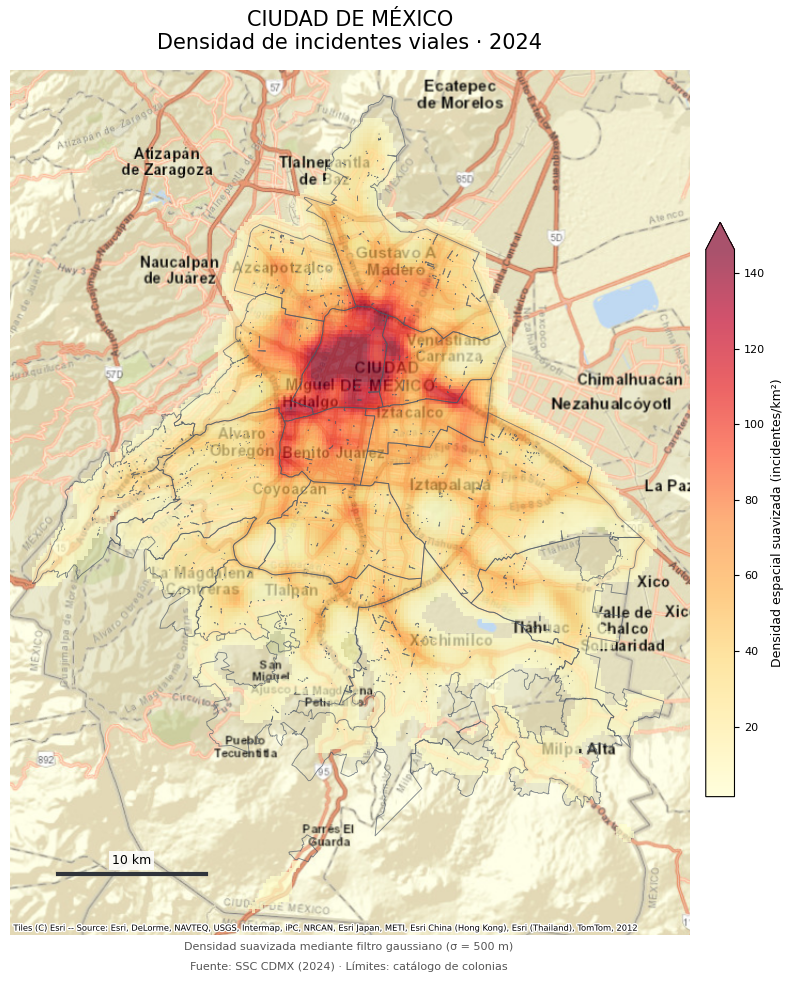
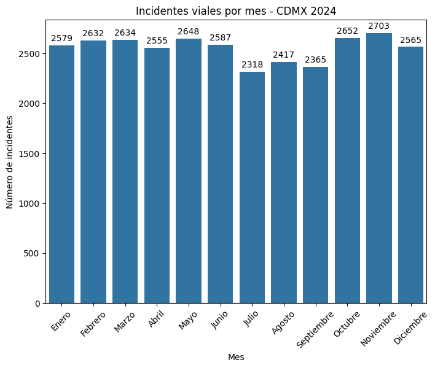
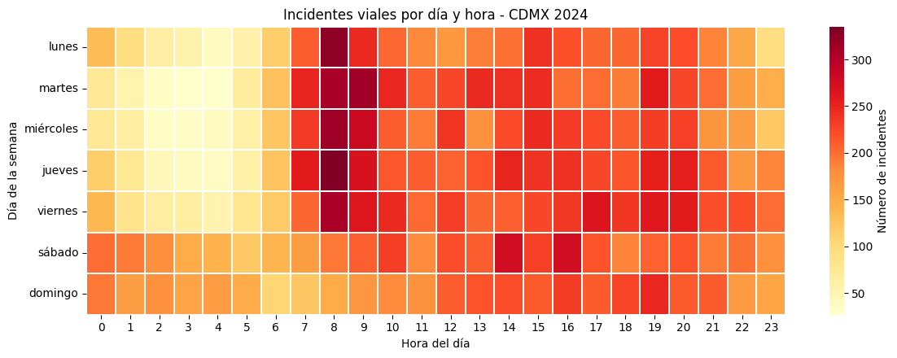
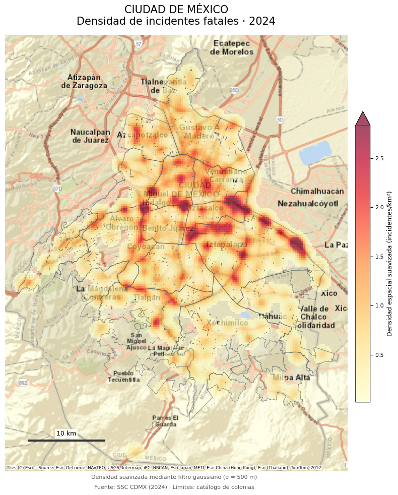

# CDMX Road Safety Intelligence · Research Showcase

**Exploratory data science and geospatial analysis of recorded road traffic incidents in Mexico City (2024).**

*Spatial concentration of recorded incidents. This is not an exposure-adjusted estimate of crash risk.*

> **Research in progress.** This public showcase presents selected work from an ongoing independent investigation. Full datasets, intermediate research files, and internal project history are kept in a separate private workspace.

## Project at a glance

The research examines **30,655 incidents** recorded by the Secretaría de Seguridad Ciudadana (SSC) in Mexico City during 2024. The analysis explores temporal patterns, participant and vehicle categories, consequences of recorded incidents, road characteristics, and geographical concentration.

### Selected results

| Recorded incidents by month | Recorded incidents by weekday and hour |
| --- | --- |
|  |  |

| Spatial incident density | Spatial density of fatal incidents |
| --- | --- |
|  |  |

**Important:** Event concentrations depend on reporting and exposure. With incident-only records and no trip denominators, these maps cannot establish a probability of a crash per trip or support causal claims.

## Notebooks

- **[02 — Exploratory Data Analysis](notebooks/02_Exploratory_Data_Analysis.ipynb):** statistical, temporal, vehicle-related, road and spatial exploration, with detailed written interpretation.
- **[03 — Machine Learning (work in progress)](notebooks/03_Machine_Learning.ipynb):** preliminary research and model-development work; not a validated operational predictive system.

The notebooks are **review copies**. Embedded outputs have been removed to avoid publishing underlying tabular results or interactive map payloads by accident. Selected graphical outputs appear above. The notebooks refer to data in a private working environment and **cannot be executed end to end from this showcase alone**.

## Data sources and reproducibility

Source records are attributed to the **Secretaría de Seguridad Ciudadana (SSC), Ciudad de México**. Geographical reference sources and the full data-provenance and reproduction notes are being documented as part of the ongoing research. Data files are intentionally **not distributed** in this public repository. This is a portfolio preview, not a complete reproducible release.

## Attribution and use

**Original analysis, code, explanatory text and visualizations © 2026 Diego Sedeño Méndez. All rights reserved**, subject to any third-party rights and applicable legal exceptions. No open-source license is granted for the author's original work at this stage. Please acknowledge and cite this project when referencing its original analysis or figures.

Suggested citation: Sedeño Méndez, D. (2026). *CDMX Road Safety Intelligence: Research Showcase* [Work in progress]. GitHub. https://github.com/dsm16/cdmx-road-safety-showcase

The original SSC data and third-party geographic materials remain subject to their respective sources' rights and terms. This copyright notice does not prevent copying technically or prohibit legally permitted uses.

---

*Independent research project · Data Science / Python / Exploratory Data Analysis / Geospatial Visualization*
